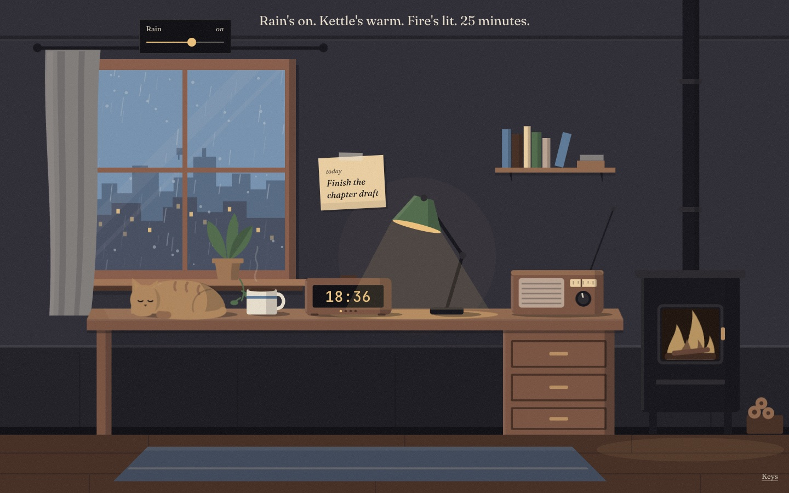
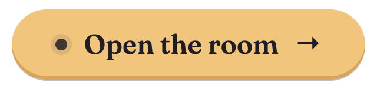
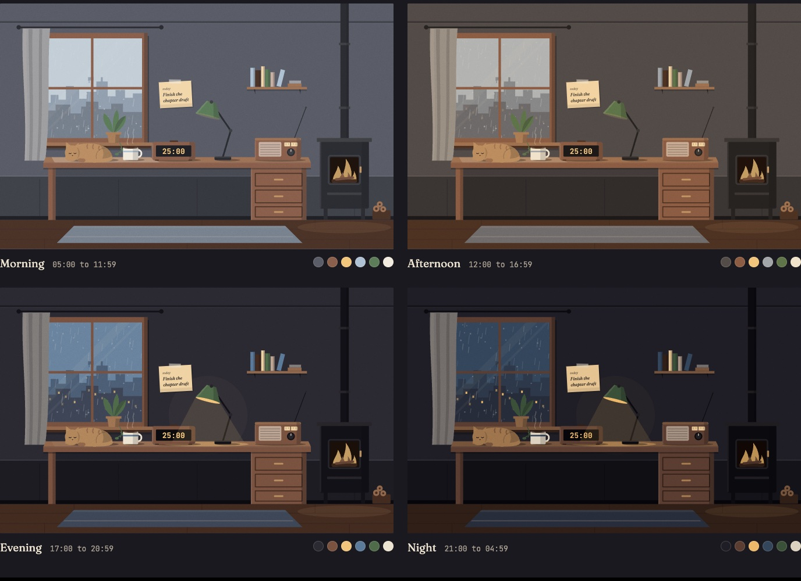
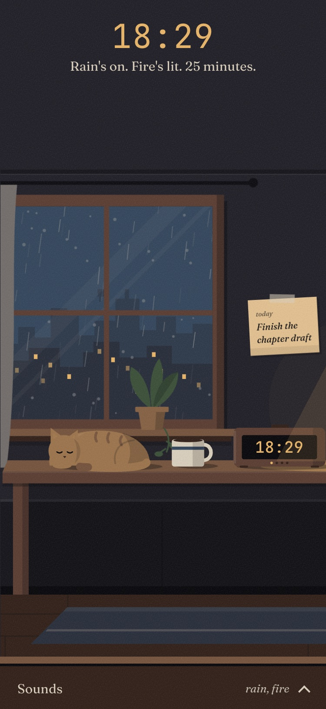

<h1 align="center">Nook</h1>

<p align="center">
  A Pomodoro timer you sit inside.<br>
  Rain on the window, a mug of something warm, a wood stove, a sleeping cat.<br>
  There are no menus. You focus by touching the room.
</p>

<p align="center">
  <a href="https://haseeb35.github.io/nook/">
    
  </a>
</p>

<p align="center">
  <a href="https://haseeb35.github.io/nook/">
    
  </a>
</p>

<p align="center">
  <sub>Free · no sign-up · installs as an app · works offline after the first visit</sub>
</p>

<!-- Demo GIF: record ~10 s of clicking the window, mug and stove, then
     starting the clock, and save it as docs/images/demo.gif. -->
> **Demo GIF:** coming soon (`docs/images/demo.gif`).

## The room is the interface

| Touch the… | and it… |
|---|---|
| **Window** | plays the rain. Streaks on the glass get denser as you turn it up. |
| **Mug** | plays a café in the next room. Steam rises while it does. |
| **Stove** | plays the fire. The flames follow the volume. |
| **Radio** | plays soft music *(waiting for a CC0 recording, see below)*. |
| **Desk clock** | starts and pauses the timer: 25 minutes of focus, 5 of rest, 15 after every fourth. |
| **Sticky note** | holds the one thing this session is for. |
| **Lamp** | turns itself on in the evening. You can overrule it. |
| **Cat** | sleeps while you work. When the break starts it stretches and sits up. |

Hover or focus an object for its label and volume. The room's light follows
your local time: morning, afternoon, evening, night.

<p>
  
  
</p>

### Keys

| Key | |
|---|---|
| `Space` | start or pause the clock |
| `S` | skip to the next session |
| `M` | mute everything |
| `1` `2` `3` `4` | rain, café, fire, radio |
| `?` | show the keys |

## How it's built

Plain HTML, CSS and JavaScript modules. No framework, no build step, no
dependencies, no trackers or third-party requests of any kind.

- **One hand-built SVG.** Every object is its own `<g>`, drawn from flat
  shapes with the light coming from the window. Six colour tokens describe
  the whole room; each time of day re-tunes the same six (registered with
  `@property`, so the room crossfades as the hour turns) instead of
  swapping artwork. Every control is a real `<button>` laid exactly over its
  object.
- **A timer that can't drift.** A running session stores only the moment it
  ends; the time left is always `endAt − Date.now()`. Throttled background
  tabs and sleeping laptops can delay a redraw, never the clock. Covered by
  a small test suite with a fake clock.
- **Real sound, never synthesised.** CC0 field recordings, prepared by
  [`scripts/prepare-sounds.sh`](scripts/prepare-sounds.sh) (ffmpeg): rumble
  filtered out, an equal-power crossfade at the loop seam, every sound levelled
  to about −23 LUFS, Opus and AAC under 400 KB each. Playback is the Web Audio
  API: gapless loops, every volume change ramped so nothing clicks, and quiet
  one-off layers (a page turning, a log settling) every 20–90 s so the loops
  never feel mechanical.
- **Careful about the person using it.** Strict Content Security Policy,
  WCAG AA contrast measured in all four lights, full keyboard use, visible
  focus, 44 px touch targets, and `prefers-reduced-motion` respected (the rain
  holds still, the cat sleeps without stirring; only fades remain). Sound never
  starts before you ask for it.
- **An installable PWA.** A service worker caches the room and each sound
  the first time it plays. Optional notifications when a session ends in a
  background tab.

The full design: mood, palette for every hour, type, motion rules and the
composition, is in [`docs/DESIGN.md`](docs/DESIGN.md).
[`docs/room-preview.html`](docs/room-preview.html) shows the art in all four
lights side by side.

## Run it locally

Any static file server will do (ES modules don't load from `file://`).

```sh
git clone https://github.com/Haseeb35/nook.git
cd nook
python3 -m http.server 8000
```

Then open <http://localhost:8000>. Add `?time=morning` (or `afternoon`,
`evening`, `night`) to see another light.

```sh
node --test tests/                 # timer engine tests (Node 18+)
scripts/prepare-sounds.sh --preview  # rebuild sounds from sounds/raw/ (needs ffmpeg)
```

The service worker caches aggressively. While editing, use a private window
or tick *Bypass for network* in your browser's dev tools.

```
index.html             the room (one inline SVG) and its controls
css/tokens.css         palette per time of day, type scale, motion
css/room.css           the scene: fills, light, object states, motion
css/ui.css             layout, tags, sliders, popovers, the phone shelf
js/main.js             app state and wiring
js/room.js             everything that touches the scene
js/timer.js            the Pomodoro engine (no DOM, tested)
js/audio.js            Web Audio: loops, levels, one-shots, chime
js/settings.js         settings and shortcuts popovers
js/storage.js          forgiving localStorage
js/early.js            sets the light before first paint
sw.js                  offline cache
sounds/SOURCES.md      where every sound came from
scripts/               the sound preparation script
docs/                  design notes, the art preview, screenshots
```

## Browser support

Tested in Chrome and in WebKit (Safari's engine), on desktop and phone sizes,
including Safari's AAC fallback for browsers without Opus. Firefox supports
everything Nook uses; it hasn't been through the automated run yet.

## Credits

### Sounds

Every recording is **CC0** (public domain), checked on its own Freesound page.
CC0 doesn't ask for credit; these people deserve it anyway.

| In the room | Recording | By |
|---|---|---|
| Rain | [20260531 Raining in Bangkok 01](https://freesound.org/s/856405/) | kijjaz |
| Café | [Cafe Ambience Day - 1](https://freesound.org/s/380202/) | lunchmoney |
| Fire | [Fire in Fireplace, Close Up, Reverberant 2](https://freesound.org/s/81801/) | silencyo |
| Page turn | [Paging through book](https://freesound.org/s/677130/) | Aurelon |

Still to come, in CC0 only: a cup clink, a log pop, the end-of-session chime
and music for the radio. [`sounds/SOURCES.md`](sounds/SOURCES.md) has the
details and candidates.

### Fonts

[Fraunces](https://github.com/undercasetype/Fraunces) and
[JetBrains Mono](https://github.com/JetBrains/JetBrainsMono), self-hosted,
under the SIL Open Font License 1.1 (see [`fonts/`](fonts/)).

## License

Code: [MIT](LICENSE). Sounds: CC0, credited above. Fonts: SIL OFL 1.1.
